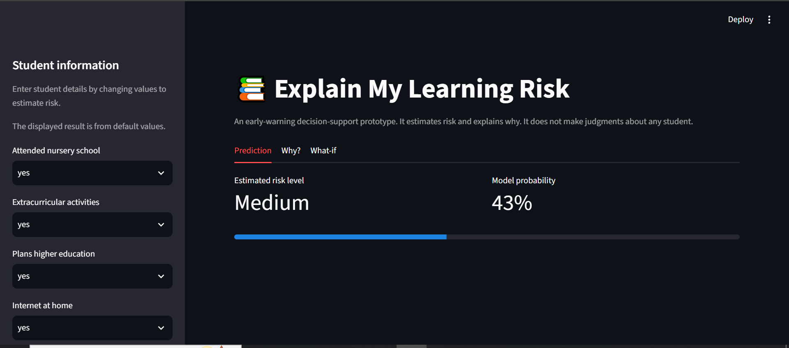
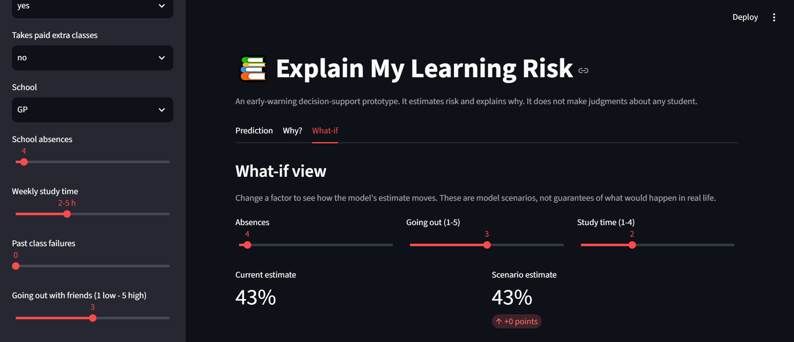
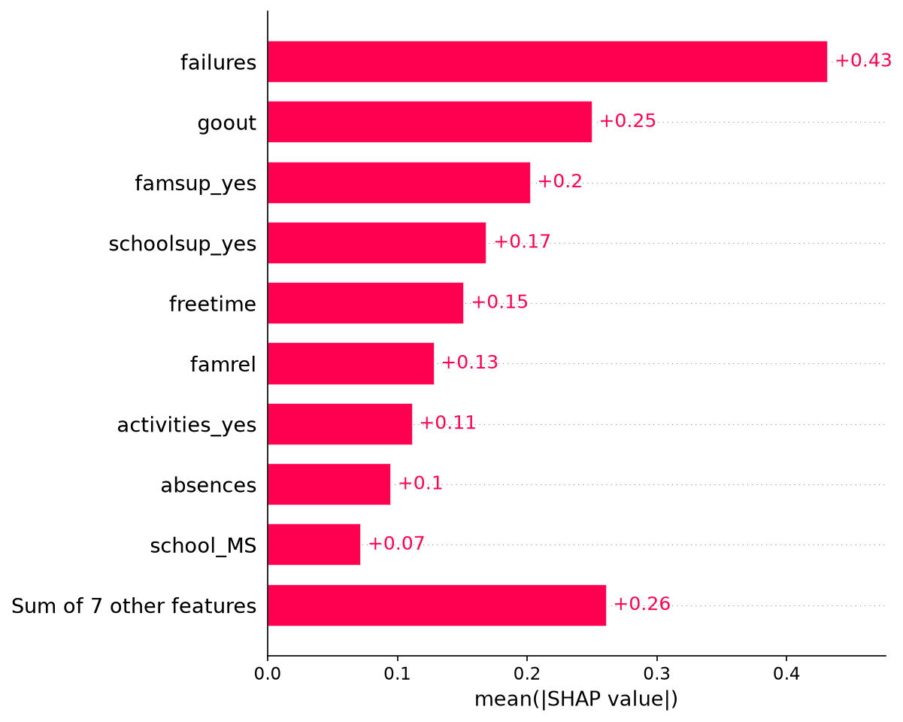

# Explain My Learning Risk

An explainable early-warning prototype that estimates whether a student may be at risk of poor academic performance and explains the estimate in simple educational language.

**Live demo:** [PASTE-YOUR-STREAMLIT-URL-HERE](https://your-app-name.streamlit.app)
**Repository:** [PASTE-YOUR-GITHUB-URL-HERE](https://github.com/YOUR-USERNAME/explain-my-learning-risk)


## Team name

Ayesha Latif

## Team members

Individual Participation

## Selected problem statement

**Explain My Learning Risk** 
Educational institutions may use data to identify students at risk of poor performance, but an unexplained prediction can be difficult for teachers and students to trust or act upon.

## Problem description

Build a student-performance prediction prototype. It should accept student information, predict a performance/risk category, identify the main factors influencing that result, and present those factors in simple educational language.

## Proposed solution

Explain My Learning Risk gives three things instead of a single score:

1. **A risk category** (Low, Medium or High) with a model probability.
2. **A plain-language explanation** of which factors raised or lowered the estimate for this student.
3. **A global view** of which factors the model relies on most across all students.

A **what-if panel** lets a teacher adjust factors such as absences or going out and see how the estimate moves. The tool is positioned as decision support for teachers and counselors, never as an automatic judgment.

It is designed as an **early-warning** tool: earlier term grades (G1, G2) are deliberately excluded, so the model relies on habits and support factors rather than on grades the teacher already knows.

## Key features

- Interactive Streamlit app with tabs: **Prediction**, **Why?**, **What-if**
- Risk bands (Low / Medium / High) with the observed at-risk rate for each band in the test data
- **Local explanation:** per-student factors, shown as plain-language sentences and a chart (SHAP-based)
- **Global explanation:** SHAP feature-importance chart across students
- What-if view for absences, going out with friends and study time
- Safer wording for support factors, which appear alongside higher risk because support tends to go to students who already need it

## Technology stack

| Layer | Tool |
|---|---|
| Language | Python 3.14 |
| Data handling | pandas, numpy |
| Machine learning | scikit-learn (logistic regression, preprocessing pipeline)  |
| Explainability | SHAP |
| Visualization | matplotlib |
| Model storage | joblib |
| Interface | Streamlit |
| Development | VS Code, Jupyter Notebook, Git and GitHub |
| Deployment | Streamlit Community Cloud |

## Screenshots
 

## Methodology

1. **Data exploration.** Loaded the dataset and checked for missing values (none) and data types. Explored how the target relates to factors such as past failures and study time.
2. **Target definition.** A student is labeled **at risk** if the final grade (G3) is below 10 out of 20, the pass mark. About 33% of students are at risk, so the classes are moderately imbalanced.
3. **Feature selection and responsible data use.** Of the 33 original columns, 16 are used as inputs:
   - *Excluded as grades (label leakage and early-warning design):* G1, G2, G3
   - *Excluded as sensitive or not actionable:* sex, age, address, family size, parental status, parental education and occupation, guardian, reason for choosing school
   - *Excluded as personal and not teacher-observable:* alcohol use (Dalc, Walc), romantic relationship
   - *Kept for fairness auditing only:* the sensitive columns remain in the full table but never enter the model
4. **Preprocessing.** Numeric features are standardized and categorical features are one-hot encoded inside a scikit-learn `Pipeline`, so test data never influences preprocessing.
5. **Train/test split.** Stratified 80/20 split (316 train, 79 test), `random_state=42`.
6. **Modeling.** Logistic regression with balanced class weights (primary, interpretable) compared against a random forest (black box) using 5-fold stratified cross-validation.
7. **Evaluation.** ROC-AUC, plus precision, recall and F1 for the at-risk class. Recall is prioritized because missing a struggling student costs more than a false alarm.
8. **Risk bands.** Predicted probabilities are mapped to Low (below 0.4), Medium (0.4 to below 0.7) and High (0.7 and above).
9. **Explainability.** SHAP for local and global explanations, plus logistic regression coefficients for direction of effect. A translation layer turns the output into plain educational sentences framed as "the model's estimate", never as a cause.
10. **App.** The trained pipeline is saved with joblib and loaded by the Streamlit app.

## Architecture / workflow

Student information (sidebar form)
            |
            v
Preprocessing pipeline (scaling + one-hot encoding)
            |
            v
Logistic regression  --->  probability  --->  Risk band (Low / Medium / High)
            |
            v
SHAP values (local and global)
            |
            v
Plain-language translation layer
            |
            v
Streamlit app: Prediction | Why? | What-if | About the model


## Installation instructions

**Requirements:** Python 3.11 or newer (the project was developed on Python 3.14) and Git.

# 1. Clone the repository
git clone https://github.com/YOUR-USERNAME/explain-my-learning-risk.git
cd explain-my-learning-risk

# 2. Create and activate a virtual environment
python -m venv venv
venv\Scripts\activate            # Windows
# source venv/bin/activate       # macOS / Linux

# 3. Install dependencies
pip install -r requirements.txt

The package versions in `requirements.txt` are pinned to the versions the model was saved with. If you use different versions, re-run the notebook to regenerate `models/risk_model.joblib`.

**Project structure**

explain-my-learning-risk/
├── app.py                      # Streamlit application
├── requirements.txt            # Pinned dependencies
├── data/
│   └── student-mat.csv         # UCI Student Performance (mathematics)
├── notebooks/
│   └── 01_explore.ipynb        # Exploration, training, evaluation, SHAP
├── models/
│   └── risk_model.joblib       # Saved pipeline and app artifacts
├── global_shap.png             # Global SHAP chart
└── README.md

## Usage instructions

**Run the app**

```bash
streamlit run app.py
```

It opens at `http://localhost:8501`.

**Using the app**

1. Enter the student's information in the **left panel**. If you cannot see it, click the arrow at the top left.
2. **Prediction** tab: shows the estimated risk level, the model probability, and how common true risk was in that band in the test data.
3. **Why?** tab: shows the factors that raised or lowered the estimate, in plain language and as a chart.
4. **What-if** tab: change absences, going out with friends or study time to see how the estimate moves. These are model scenarios, not guarantees.
5. **About the model** tab: data, method, performance, the global factor chart and limitations.

**Reproduce the model**

Open `notebooks/01_explore.ipynb`, choose the `venv` kernel, and use **Run All**. The last cell saves `models/risk_model.joblib`.

## Dataset information

- **Name:** UCI Student Performance dataset
- **File used:** `student-mat.csv` (mathematics course)
- **Size:** 395 students, 33 original columns, no missing values
- **Origin:** secondary-school students from two Portuguese schools, collected from school reports and questionnaires
- **Target created:** `at_risk = 1` if final grade G3 is below 10, otherwise 0 (about 67% not at risk, 33% at risk)
- **Not used:** `student-por.csv` (Portuguese course), because many students appear in both files and merging them would double-count students

## Models used

| Model | Role | Cross-validated ROC-AUC |
|---|---|---|
| **Logistic regression** (balanced class weights) | Final, interpretable model used in the app | 0.636 (±0.053) |
| Random forest (300 trees, max depth 6, balanced class weights) | Black-box comparison | 0.674 (±0.091) |

The random forest scored about 0.04 higher, which is within its run-to-run variation (±0.09). Because the difference is small and uncertain, the interpretable logistic regression was kept, since a tool built to explain predictions should itself be interpretable.

## Results

**Held-out test set (79 students: 53 not at risk, 26 at risk), logistic regression at the default 0.5 threshold:**

| Metric | Value |
|---|---|
| ROC-AUC | 0.71 |
| Accuracy | 0.65 |
| At-risk precision | 0.47 |
| At-risk recall | 0.58 |
| At-risk F1 | 0.52 |

Accuracy alone is misleading here, because predicting "nobody is at risk" would already score 67% while catching no one.

**Precision and recall at different thresholds:**

| Threshold | Precision | Recall | Students flagged |
|---|---|---|---|
| 0.4 | 0.45 | 0.88 | 51 |
| 0.5 | 0.47 | 0.58 | 32 |
| 0.6 | 0.50 | 0.38 | 20 |
| 0.7 | 0.69 | 0.35 | 13 |

**Risk bands on the test set:**

| Band | Probability | Students | Share truly at risk |
|---|---|---|---|
| Low | below 0.4 | 28 | 11% |
| Medium | 0.4 to below 0.7 | 38 | 37% |
| High | 0.7 and above | 13 | 69% |

The share of truly at-risk students rises from Low to Medium to High, so the labels carry information. The 0.4 and 0.7 cut-offs were chosen after viewing test-set results, and the bands are small, so these figures are indicative only.

**What the model relies on (global SHAP, mean absolute value):**

| Rank | Factor | Mean abs. SHAP |
|---|---|---|
| 1 | Past class failures | 0.43 |
| 2 | Going out with friends | 0.25 |
| 3 | Family educational support | 0.20 |
| 4 | Extra school support | 0.17 |
| 5 | Free time after school | 0.15 |
| 6 | Family relationship quality | 0.13 |
| 7 | Extracurricular activities | 0.11 |
| 8 | School absences | 0.10 |

**Direction of effect (logistic regression coefficients):** past failures, extra school support, family support and going out with friends push the estimate up; planning higher education, home internet access, free time and family relationship quality push it down. Study time has almost no effect in this model.

**Key observations**

- Past failures is the strongest factor, consistent with the raw data: the at-risk share rises from 25% (no failures, 312 students) to 52% (one failure, 50 students) and about 75-80% for two or more failures (only 33 students).
- Support factors (extra school support and family support) appear alongside **higher** risk. This most likely reflects support going to students who already struggle, not support causing risk, so the app words these differently.
- Without prior grades the model has modest predictive power. This is expected and is stated openly because the tool is a screening aid, not a precise predictor.

## Screenshots / demo

**Global explanation (SHAP):**



**App screenshots:** *(add images to a `screenshots/` folder and update the paths)*

| Prediction | Why? |
|---|---|
|  |  |

| What-if | About the model |
|---|---|
|  |  |

**Live demo:** [PASTE-YOUR-STREAMLIT-URL-HERE](https://your-app-name.streamlit.app)

## Limitations

- **Small, old, single-region data:** 395 students from two Portuguese schools; results may not generalize to other schools, countries or years.
- **Modest predictive power:** cross-validated ROC-AUC is about 0.64 (0.71 on the held-out test set). The tool should be used to start a conversation, not to make a decision.
- **Small test set and small groups:** the test set has 79 students and some categories are tiny (for example, 16-17 students with two or three past failures), so exact percentages are noisy.
- **Thresholds tuned after viewing test results:** the 0.4 and 0.7 risk-band cut-offs were chosen after looking at test-set performance, so reported band results are slightly optimistic.
- **Simplified target:** a pass/fail cut at 10/20 reduces a student's performance to one threshold.
- **Associations, not causes:** explanations describe model behavior. For example, support factors appear alongside higher risk because support is targeted at struggling students.
- **Some counter-intuitive coefficients** (for example extracurricular activities and free time) are likely noise given the sample size and should not be interpreted.
- **No external validation** on a separate school or year.
- **Not yet done:** formal subgroup fairness analysis, an agreement check between two explanation methods, and a user comprehension study (see Future scope).

**Ethical considerations**

- Predictions are probabilities meant to support human conversations, not automatic decisions about students.
- Sensitive attributes (sex, age, address, parental information) and personal attributes (alcohol use, relationship status) are excluded from the model.
- A risk label can stigmatize a student if misused; a teacher or counselor must make any decision, and the interface repeats this.
- The model should be re-validated on local data before any real-world use.

## Future scope

- **Subgroup fairness analysis:** compare recall and flag rates across groups such as sex and address type (using the columns kept aside for this purpose), with the caveat that subgroups are small.
- **Explanation consistency:** compare SHAP with permutation importance and test stability across random seeds.
- **Second checkpoint model:** add G1 as an input for use after the first assessment, and compare accuracy and explanations with the habits-only early-warning model.
- **User comprehension test:** ask teachers or students to interpret explanations and report how well they understood and trusted them.
- **Counterfactual explanations:** suggest the smallest realistic change that would move a student to a lower band.
- **Calibration and threshold selection** on a separate validation set.
- **Validation on other data**, such as the Portuguese-course file or data from other schools.
- **Natural-language explanations** and multi-language support.

## External resources / attributions

- **Dataset:** *Student Performance Data Set by UCI.* downloaded from [Kaggle](https://www.kaggle.com/datasets/dskagglemt/student-performance-data-set) (Student Performance dataset) (https://archive.ics.uci.edu/ml/datasets/student+performance).
- **Libraries:** [scikit-learn](https://scikit-learn.org/), [SHAP](https://shap.readthedocs.io/), [Streamlit](https://streamlit.io/), [pandas](https://pandas.pydata.org/), [NumPy](https://numpy.org/), [Matplotlib](https://matplotlib.org/), [joblib](https://joblib.readthedocs.io/).
- **Hosting:** [Streamlit Community Cloud](https://streamlit.io/cloud).
- **AI assistance:** parts of the code, were developed with the help of an AI assistant (Claude by Anthropic) and reviewed by myself.
